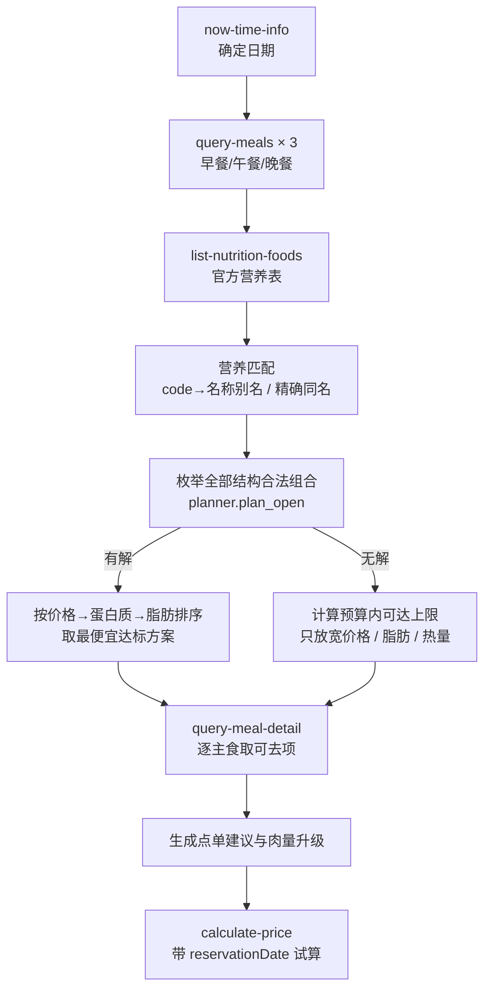

# MCP 集成说明

本项目的菜单、门店价格、营养数据全部来自麦当劳中国 MCP 服务，不 mock、不硬编码价格。离线模式只用于测试，界面会明确标注 `offline`。

---

## 1. MCP Server 与鉴权

| 项目 | 值 |
| --- | --- |
| Server | `https://mcp.mcd.cn` |
| 传输 | streamable HTTP（JSON-RPC over HTTP） |
| 鉴权 | 请求头 `Authorization: Bearer <token>` |
| Token 来源 | 环境变量 `MCD_MCP_TOKEN`，或本机 `~/.workbuddy/mcp.json` 中 `mcpServers["mcd-mcp"].headers.Authorization` |
| 客户端实现 | `src/mcp_client.py` |

`src/mcp_client.py::resolve_token()` 按上述顺序取 Token；无论配置里有没有 `Bearer ` 前缀，都会用 `_norm_bearer()` 补齐。

**Token 约束**：不打印、不写日志、不进前端、不进 fixture、不进 `mcp-config.example.json`。客户端只把 Token 放进请求头，异常信息也不带它。

可选环境变量：

| 变量 | 默认 | 说明 |
| --- | --- | --- |
| `MCD_MCP_TOKEN` | 空 | 直接给 Token |
| `MCD_MCP_CONFIG` | `~/.workbuddy/mcp.json` | 配置文件路径 |
| `MCD_MCP_SERVER` | `mcd-mcp` | 配置里的 server key |
| `MAI_MAI_DATA` | `data/` | 缓存与运行数据目录 |

---

## 2. 实际调用的 Tools

| Tool | 用途 | 本项目调用点 |
| --- | --- | --- |
| `now-time-info` | 取服务器日期与时区，决定默认规划日期 | `Service.context()`（`src/service.py`） |
| `query-meals` | 按门店 + 餐次时间取菜单（早/午/晚各一次） | `Service.refresh()` |
| `list-nutrition-foods` | 全量官方营养表（160 行 / 158 个唯一名称） | `Service.refresh()` |
| `query-meal-detail` | 单 SKU 特调树，取可去项（`unselectedKey` / `selectedKey`） | `Service.removable_options()`，逐主食调用 |
| `calculate-price` | 当前方案的组合试算价（带 `reservationDate`） | `Service.quote_meal()` |

只在查询与试算链路里调用，没有调用任何下单、券、积分、地址相关接口。

---

## 3. 调用流程



每次刷新菜单会写入按「门店 + 日期 + beType + orderType + 各餐次时间」哈希隔离的缓存文件；换门店或换时段会重新拉取，缓存来源在接口和页面都会标注。

---

## 4. 协议细节（实测踩过的坑）

### 4.1 Authorization 必须带 `Bearer `

配置里如果是裸 Token，服务端返回：

```json
{"code": "400003", "msg": "校验鉴权authToken必填!"}
```

补上 `Bearer ` 前缀后 `initialize` 才返回 200。

### 4.2 到店自取不传 `beCode`

`beType=1` + `orderType=1`（本项目固定使用到店自取）时**不要传 `beCode`**，传了会报错。

### 4.3 `calculate-price` 必须带 `reservationDate`

不带时只按**当前时刻**判断在售。凌晨给明天的晚餐报价会全量返回：

```
商品已售罄或不可售，换一个商品或检查orderType/beType
```

带上 `reservationDate: "2026-10-20 18:30"` 后同一商品正常返回 `price: 2400`。所以本项目每餐单独报价，并在结果里回传 `reservation_date`。

### 4.4 金额单位是分

`data.price` / `data.originalPrice` / `data.discount` 都是**分**，展示一律除以 100。

### 4.5 `modification` 要整组传

对含 `unselectedKey` 的特调组，**组内所有项都要传**：选中项用 `selectedKey`，未选中项用 `unselectedKey`，否则整组可能被忽略。

去吉士示例（双层吉士汉堡 `1120`，吉士选项 `100141`）：

```json
{"productCode": "1120", "quantity": 1,
 "modification": {"values": [
   {"code": "100141", "key": "0-0", "quantity": 1},
   {"code": "120512", "key": "0-1", "quantity": 1}
 ]}}
```

去料本身 `price: 0`，所以价格不变是**正确**结果，不是接口故障。

### 4.6 特调必须按餐次时间查

同一个 SKU 在早餐时段可售、午餐时段可能已下架。用 12:15 查早餐商品 `514700` 的详情会返回：

```
60001 未匹配到商品，请重新拉取全量商品列表
```

所以 `query-meal-detail` 一律带上该 SKU 所属餐次的时间，detail 缓存 key 也带餐次时间。

### 4.7 菜单按餐次时间变化

同一门店，`reservationDate` 不同返回不同 SKU 集：

- `08:15` → 超值早餐 / 麦满分系列 / 粥王系列 / 早安营养卷 …
- `12:15` / `18:30` → 鸡肉汉堡卷 / 巨无霸 / 安格斯 / 蘸料炸鸡 …

午餐与晚餐的 SKU 集合完全相同，接口本身不区分「午餐菜单」与「晚餐菜单」，只能靠时点区分。早餐池与正餐池必须分开取，不能复用。

---

## 5. 数据落盘

```
data/cache/<日期>__<门店>__<上下文哈希>.json   该上下文的菜单 + 营养表 + 抓取时间（不入库）
data/fixtures/*.json                          真实响应快照，离线测试用，无 Token
data/aliases.json                             code → 权威名称 + 证据
data/upgrade_ladder.json                      肉量升级配对（人工核对肉饼数量与官方营养）
```

缓存带 `fetched_at`，界面顶部显示数据来源（`live` / `cache` / `offline`）与时间，不会把旧数据当实时结果。

---

## 6. 失败处理

| 情况 | 表现 |
| --- | --- |
| 无 Token | `McpError(stage="auth")`，界面提示，不降级造假 |
| 网络 / 超时 | `stage="transport"` |
| 业务失败（如商品不可售） | 返回 `{status:"failed", message: 原始 message}`，金额为 `null` |
| 报价失败 | 结果卡显示「试算失败：…」，金额与判定按菜单参考价，并注明 |
| 缺营养 | SKU 列入「数据缺失」，不进入求解，合计标「缺项」 |

---

## 7. 业务价值

- **用户省了什么**：不用在菜单页和营养表之间来回对照，也不用自己试组合。给定「蛋白质下限 + 预算」，直接得到最便宜的可点方案；达不到时，明确知道差多少克、加多少钱能达标。
- **为什么必须用 MCP**：价格和供应是门店级、时段级的实时状态，营养是官方口径。离线写死一份菜单，第二天就会算错价；让模型自己估营养，则会给出看似合理但不可核对的结果。
- **为什么计算不交给模型**：一百多个 SKU 的组合枚举、硬约束过滤和排序是可验证的确定性计算，放在 `src/planner.py` 里比让模型口算可靠，也能被单元测试覆盖。

---

## 8. 明确不做的事

- 不下单（`create-order` 从未调用）
- 不取消订单、不领券、不使用积分、不抽奖
- 不新增配送地址
- 不请求外送场景（固定到店自取）
- 不在前端或示例配置里放任何真实 Token
