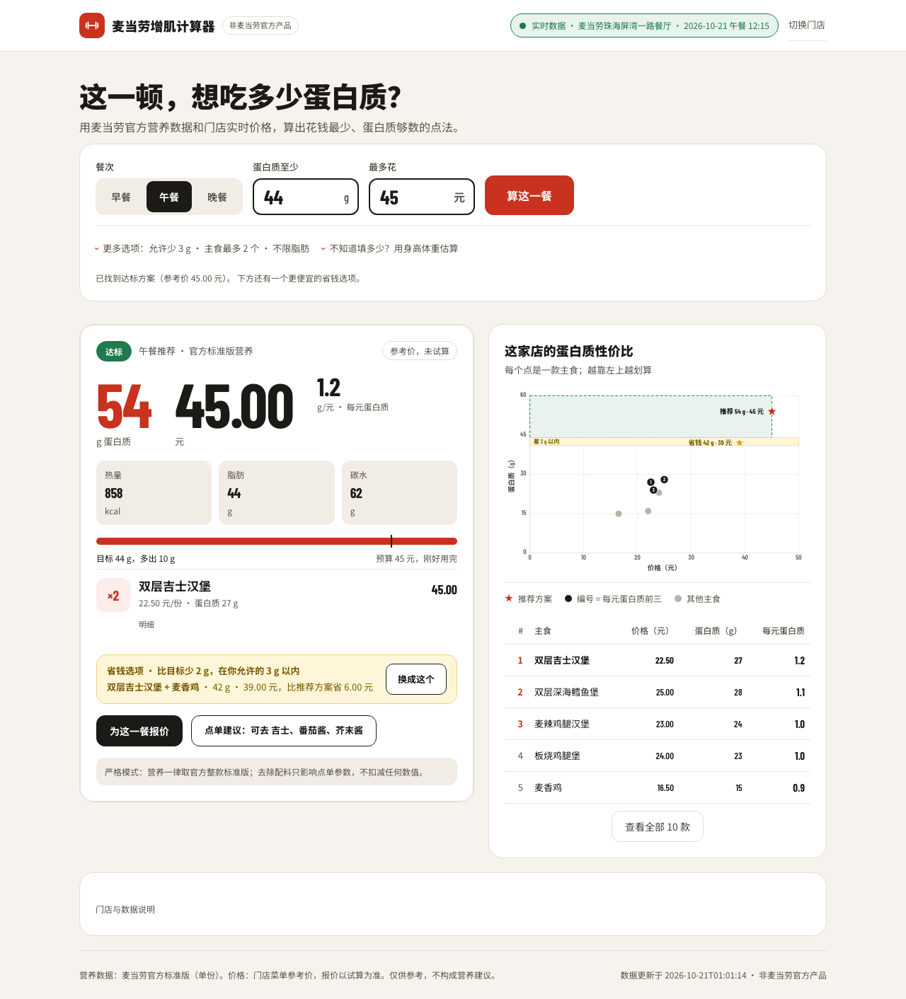
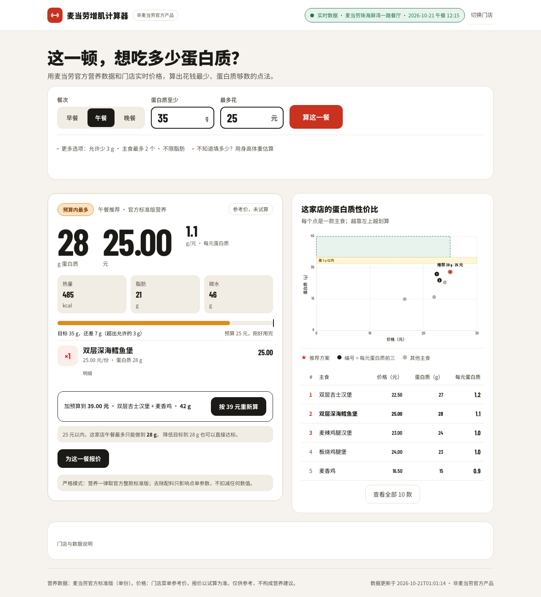
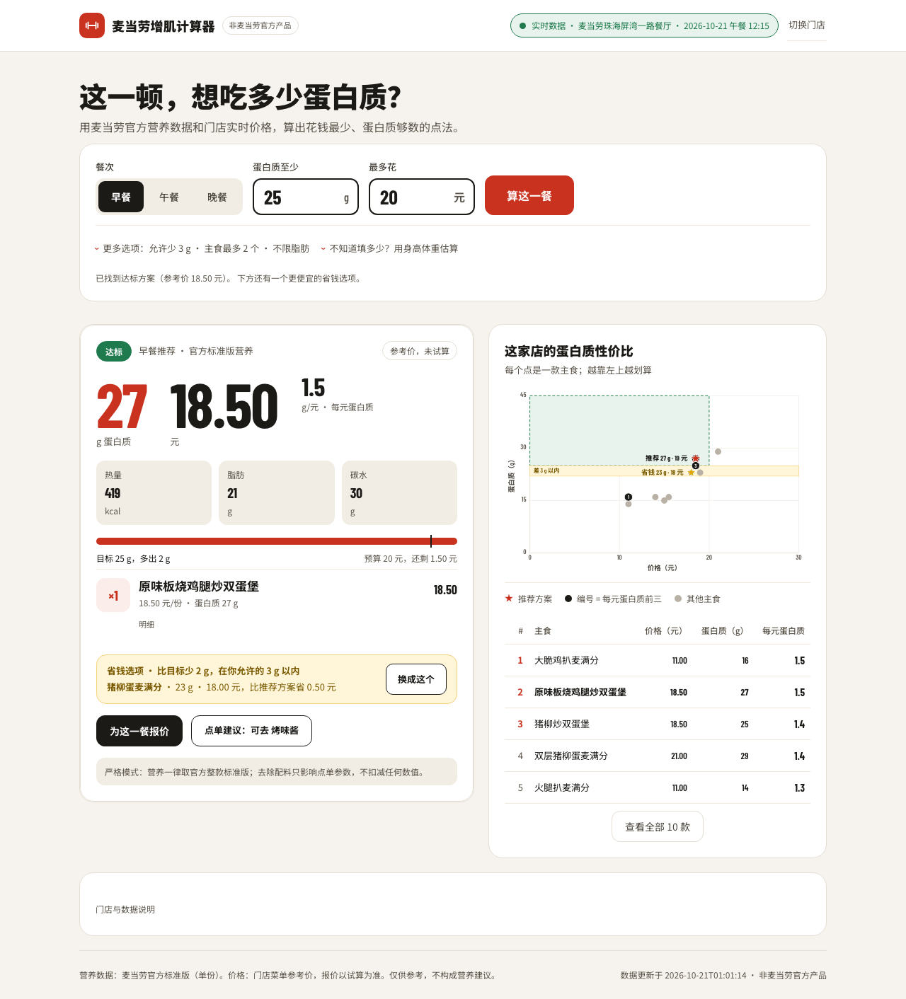

# 麦当劳增肌计算器

输入这一顿想吃多少蛋白质、最多花多少钱，算出麦当劳里最划算的点法。

麦当劳程序员创意开发大赛参赛作品 · 非麦当劳官方产品

---

## 先看结果

麦当劳珠海屏湾一路餐厅（门店 `1440054`），2026-10-21 午餐 12:15 的实时菜单与试算价：

| 你的目标 | 算出来的点法 | 蛋白质 | 价格 |
| --- | --- | --- | --- |
| 44 g / 45 元 | 双层吉士汉堡 ×2 | **54 g** | **45.00 元** |
| 同上，想更省 | 双层吉士汉堡 + 麦香鸡（省钱选项，比目标少 2 g，在 3 g 容差内） | 42 g | 39.00 元 |
| 35 g / 25 元 | 预算内最多：双层深海鳕鱼堡 ×1 | 28 g（差 7 g） | 25.00 元 |
| 同上，加到 39 元 | 双层吉士汉堡 + 麦香鸡 | 42 g | 39.00 元 |

价格为该时段试算价，不是结算价。第二行的「44 g 目标」之所以接受 42 g，是因为默认允许少 3 g，页面会明写「比目标少 2 g」。

| 桌面：44 g / 45 元 | 手机：35 g / 25 元 |
| --- | --- |
|  |  |

另外四个场景，桌面 1280px 与手机 390px 各一套：

| 场景 | 桌面 | 手机 |
| --- | --- | --- |
| 午餐 35 g / 25 元（预算内最多） |  |  |
| 早餐 25 g / 20 元（达标） |  |  |

---

## 它解决什么问题

想增肌的学生和上班族站在麦当劳柜台前，真正想知道的是「这顿要吃够蛋白质，最少花多少钱」，但菜单上只有单品价格，营养表在另一个页面。

把这件事交给大模型口算更危险：一百多个 SKU、套餐与单品混在一起，蛋白质和价格都容易算错，而且模型会「估」出一个看起来合理的数字。

这个项目把三件事拆开：菜单、价格、营养从麦当劳 MCP 取真实数据；组合枚举与达标判定由本地代码确定性计算；自然语言理解和结果表达交给 WorkBuddy 的 Agent。

## 目标用户

- 预算有限、想用最少的钱补够蛋白质的学生
- 在增肌或控制体脂、需要每餐蛋白质下限的健身人群
- 经常吃麦当劳、想知道「怎么点更值」的上班族

## 功能

- **单餐计算**：主食 1–2 个（可设 1 或 3），饮品只从白名单里加 0–1 杯，价格上限是硬约束
- **容差**：默认允许比目标少 3 g（0–10 可调），返回「达标 / 接近达标 / 预算内最多」三态，并给出更便宜的省钱选项
- **无解时**：给出预算内蛋白质最高的组合，以及只放宽价格（或只放宽脂肪、热量）需要放宽到多少
- **蛋白质性价比图**：横轴价格、纵轴蛋白质，高亮每元蛋白质最高的前 3 款，配一张排行表
- **身体数据估算**：按体重、年龄、活动量估算每餐蛋白质与热量，只做参考，不自动变成约束
- **点单建议**：从 POS 真实返回的可去项里生成，只改点单参数，不扣减营养数值
- **门店实时试算价**：按当前门店、日期、餐次时间调用 `calculate-price`
- **严格模式**：所有营养数字都取官方标准版整款数据，不估算、不外推

## 取数交给 MCP，计算交给代码，表达交给 Agent

| 层 | 负责什么 | 具体实现 |
| --- | --- | --- |
| 麦当劳 MCP | 真实菜单、门店价格、官方营养 | `now-time-info`、`query-meals`、`list-nutrition-foods`、`query-meal-detail`、`calculate-price` |
| 本地求解器 | 枚举组合、硬约束、排序、容差、可达上限 | `src/planner.py`、`src/catalog.py`、`src/service.py` |
| WorkBuddy Skill | 听懂需求、决定传哪些约束、把结果说成人话 | `skills/mcd-protein-calculator/SKILL.md` |

## 安装

1. **申请麦当劳 MCP Token**

   打开 <https://open.mcd.cn/mcp>，手机号登录，在控制台激活并领取 Token（免费）。

2. **配置 MCP**

   对照仓库里的 [`mcp-config.example.json`](mcp-config.example.json)，把 Token 放进环境变量 `MCD_MCP_TOKEN`，不要写进配置文件：

   ```bash
   export MCD_MCP_TOKEN="<你的 token>"
   ```

   代码也支持从 WorkBuddy 已连接的 `~/.workbuddy/mcp.json` 里读取 `mcd-mcp` 的 Authorization，本地开发时可以不设环境变量。

3. **安装 Skill**

   ```bash
   mkdir -p ~/.workbuddy/skills
   cp -r skills/mcd-protein-calculator ~/.workbuddy/skills/
   ```

   装好后在 WorkBuddy 里直接问「午饭想吃够 40 g 蛋白质，35 块以内怎么点」即可。

4. **本地网页**

   ```bash
   python3 src/server.py          # http://127.0.0.1:8765
   python3 src/server.py --offline  # 无网络时用 fixture，页面会标「离线样例数据」
   ```

仓库结构：

```
.
├── README.md
├── CONTEST_DECLARATION.md
├── MCP_INTEGRATION.md
├── mcp-config.example.json
├── workbuddy.md
├── LICENSE
├── src/          # 求解器、MCP 客户端、HTTP 服务
├── web/          # 单页界面（原生 SVG 图表，无外部依赖）
├── tests/        # 单元测试、HTTP 验收、浏览器脚本
├── scripts/      # 真实链路自检
├── data/         # 别名表、升级阶梯、离线 fixture
├── skills/mcd-protein-calculator/SKILL.md
└── docs/
    ├── screenshots/
    └── dev-log/  # 02–14 开发记录
```

## 使用示例

以下是 WorkBuddy 新会话里的真实对话（门店 1440054，2026-10-20 午餐 12:15，默认 3 g 容差）：

> **你**：我在珠海屏湾一路的麦当劳，午饭想吃够 40 克蛋白质，35 块以内，怎么点？
>
> **WorkBuddy**：当前条件下没有满足全部要求的方案。预算内最多：培根安格斯厚牛堡 ×1，34.5 元（参考价），蛋白质 34 g，距 40 g 目标差 6 g。只放宽价格的话，最低 39 元可以到 42 g，方案是双层吉士汉堡 + 麦香鸡。

> **你**：那如果预算放到 45 呢？
>
> **WorkBuddy**：45 元够了，达到目标：双层吉士汉堡 ×1 + 麦香鸡 ×1，39 元（时段试算价），蛋白质 42 g、脂肪 39 g、热量 798 kcal，每元 1.1 g 蛋白质，预算还剩 6 元。

> **你**：帮我把芝士去掉再算一下价格。
>
> **WorkBuddy**：已去掉双层吉士汉堡里的吉士，试算总价仍是 39 元（吉士这项标价 0 元）。蛋白质仍显示 42 g，但这是官方标准版数值；本工具没有扣减芝士的营养，实际成品可能低于显示值。

网页版更直接：选餐次、填蛋白质下限和预算、点「算这一餐」，结果卡给出组合、每元蛋白质、达标差额与预算余额；下面的散点图可以看这家店这一餐所有主食的性价比分布。

## 真实性对照表

| 数据 | 本项目的做法 |
| --- | --- |
| 菜单 / 价格 | 每次从 MCP 实时查询（按门店 + 餐次时间），缓存会标注来源与抓取时间 |
| 营养 | 麦当劳官方标准版整款数据（`list-nutrition-foods`） |
| 去配料后的营养 | **不估算**，仍显示标准版数值，并在文案里说明「实际可能低于显示值」 |
| 加肉饼 | MCP 餐品侧没有肉饼加料 SKU，**不提供**，只给整款升级替代 |
| 下单 / 领券 / 积分 | **不做**，只查询与试算 |

## 实测发现

这些是开发过程中在真实接口上踩到的坑，也是本项目几个设计选择的理由：

1. **加料项不计价**：特调里加浓缩咖啡标价 +5 元、换燕麦奶 +2 元，但 `calculate-price` 不会把加价算进总价。所以本项目不用加料来凑价格，只用整款商品。
2. **没有加肉饼这个选项**：抽检 5 款餐品，全部只支持去料（`suggest_remove`），餐品侧没有肉饼加料 SKU。用户问「能加一块肉饼吗」，只能给整款替代（麦香鱼 → 双层深海鳕鱼堡）。
3. **早餐商品必须用早餐时段查询**：同一个 SKU 在 08:15 能查到详情，用 12:15 查会返回 `60001 未匹配到商品`。所以每次查详情都带上该餐次的时间。
4. **午餐和晚餐菜单完全相同**：同一门店 12:15 与 18:30 返回的 SKU 集合相等，接口不区分「午餐菜单」和「晚餐菜单」，只能靠 `reservationDate` 的时点区分。
5. **时段间隙会返回早餐菜单**：把午餐设成 10:30，接口返回的却是早餐的 88 个 SKU。页面会显示「午餐时段 10:30 返回的菜单与早餐完全相同，请确认取餐时间」。
6. **报价必须带 `reservationDate`**：不带时只按当前时刻判断在售，凌晨给明天的晚餐报价会全部返回 `60006 商品已售罄或不可售`。带上餐次时间后同一商品正常返回价格。

## 测试

| 套件 | 数量 | 覆盖 |
| --- | --- | --- |
| `tests/test_*.py`（离线单元） | 93 | 求解与排序、容差三态、营养匹配、数量契约、数据源判定 |
| `tests/acceptance_http.py` | 77 | HTTP 契约、签名校验、409 分支、无解与放宽 |
| `tests/*.mjs`（浏览器，可选，需 Chrome） | 8 个脚本 | 页面布局、图表坐标、截图与边界场景 |

复跑命令：

```bash
NO_PROXY=127.0.0.1,localhost python3 -m unittest discover -s tests -p "test_*.py"

python3 src/server.py --offline --port 8771 &
NO_PROXY=127.0.0.1,localhost python3 tests/acceptance_http.py http://127.0.0.1:8771
```

浏览器套件需要本机 Chrome，且服务要跑在独立数据目录上，例如 `MAI_MAI_DATA=/tmp/mai-accept python3 src/server.py --offline --port 8771`。

## 免责声明

- 本项目是麦当劳程序员创意开发大赛参赛作品，**非麦当劳官方产品**。
- 输出仅供参考，不构成营养、医疗或其他专业建议。
- 餐品信息、价格与供应状态以麦当劳官方渠道的实时结果为准；本工具给出的价格是所选时段的试算参考价，不是结算价。
- 本项目不下单、不付款、不领券、不操作积分、不新增地址。

## License

[MIT](LICENSE)
